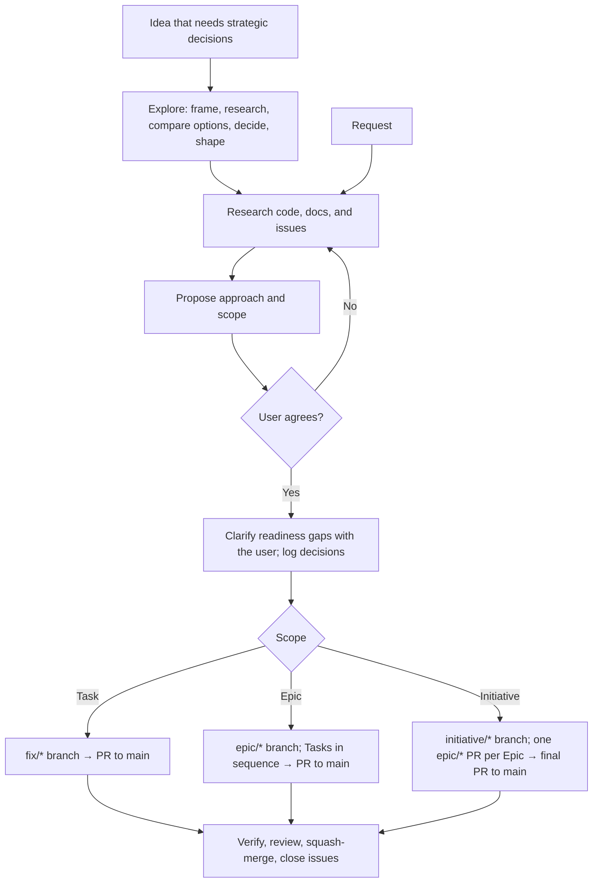

# Orchi

### One workflow for Claude Code.

**Research first. Agree the scope. Deliver through branches and GitHub Issues.**

Orchi is a development convention packaged as one agent skill, with seven optional entry skills (one of them, `/orchi`, the entry of a session pool) and six model-tiered subagents. Git stores code and documentation; GitHub Issues store ownership, hierarchy, dependencies, and status. There is no controller, state database, approval receipt, or mandatory command facade. It installs into **Claude Code**.

[Quick start](#quick-start) · [How it works](#how-it-works) · [Subagents and entry skills](#subagents-and-entry-skills) · [Project instructions](#project-instructions) · [Documentation](#documentation)

---

## Quick start

### 1. Install from your project

Run this in the repository where you want to use Orchi:

```bash
npx --yes github:nkhus/orchi
```

The current directory is the installation target; use `--project /path/to/project` to choose another one.

**Prerequisites:** Git, the GitHub CLI (`gh`, authenticated) for Issue and PR work, Python 3.11+ for the bundled standard-library scripts, and Node.js 18.19+ with `npx`, which installs [Impeccable](https://impeccable.style/), the design skill Orchi installs with itself. The `npx` installer also needs `uv`. Use macOS, Linux, or WSL.

<details>
<summary><strong>Install across projects, preview changes, or remove Orchi</strong></summary>

```bash
npx --yes github:nkhus/orchi --global
```

| Option | Effect |
| --- | --- |
| `--github` | Also add issue templates, a PR template, documentation, design, and standards check workflows, and Orchi labels (project scope) |
| `--no-docs-workflow` | With `--github`, skip the documentation check workflow; `--docs-workflow` restores it |
| `--dry-run` | Show planned file changes, conflicts, and the labels `--github` would create, without writing |
| `--replace-orchi` | Back up and replace locally edited Orchi files, and replace an Impeccable of another version with the pinned one |
| `--version` | Show the installed and bundled versions and the upgrade command |
| `--uninstall` | Remove the complete managed Orchi installation at the selected scope |

To upgrade, rerun the same `npx` command; unmodified managed files update in place. See the [installation guide](docs/installation.md) for paths, conflict handling, upgrading from earlier versions, offline installation, and removal.

</details>

### 2. Start a request

Open a fresh Claude Code session and ask:

```text
Use Orchi to add CSV export to the orders page.
```

Claude Code loads the `orchi-core` skill for such requests by itself; it is hidden from the slash-command menu because you never need to type it. The installed project instructions also route implementation requests to Orchi. You can also start with the [entry skills](#subagents-and-entry-skills): `/orchi-plan <request>`.

## How it works



- **Explore before planning when the direction is open.** For a new project, module, or feature that needs strategic decisions, `orchi-explore` frames the idea with the user, sends `orchi-researcher` agents to primary sources and to design at least three different options, records each decision, and keeps the whole map in one `Exploration` Issue. Planning takes that Issue as agreed input for an Initiative, Epic, or Task.
- **Design with you, then build what you approved.** Orchi installs [Impeccable](https://impeccable.style/) as its design engine. Planning gives work that changes a user interface a design depth: none, a brief that `orchi-plan` shapes with you, or a `design` Epic that `orchi-design` runs with you. You choose every direction and approve every comp, at every autonomy level; writers build only against them, and the review adds Impeccable's audit. A new project gets `PRODUCT.md` from its exploration and `DESIGN.md` from its first design Epic.
- **Standards by default, enforced by tools.** Orchi assumes agents write the code and nobody reads it, so tools do the code review. You answer product questions (who uses it, where it runs, what data it holds, the budget, proof of concept or lasting); `orchi-standards` derives the stack and checks from Orchi's [defaults](skills/orchi-core/references/standards.md) (strict TypeScript, or Python for data work) and plans a foundation Epic that every other Epic waits for. It commits `ENGINEERING.md` with the checks it declares, each a blocking CI job: format, lint, strict types, tests with 90% coverage of changed lines, an acceptance test per criterion, accessibility, module boundaries, size limits, dead code, secrets, dependency and static security analysis, and licenses. `standards.py ratchet` fails a PR that adds a suppression, loosens a check, or deletes a test without an exception recorded in `ENGINEERING.md`, and each exception reaches you in plain words. An existing project gets an audit and one standards Epic.
- **Agree before tracking.** Research, a proposed scope, and then the proposed breakdown into Epics or Tasks come first. Branches, Issues, and changes follow the user's agreement, not an agent's guess. A request that was declined before is proposed with its earlier reason, and a new refusal is recorded.
- **Scale the ceremony to the work.** A small fix is one Task and one PR. An Epic is one branch and one PR with sequential Tasks. An Initiative integrates several Epic PRs on its own branch before one final PR to main.
- **Every title shows its lineage.** Initiatives and Epics have short tags, and titles start with them: Initiative `[PAY] Card payments`, Epic `[PAY][TOKEN] Tokenize stored cards`, Task `[PAY][TOKEN] Add token column`. Labels carry the type, and branches reuse the tags (`epic/pay-token-tokenize-cards`).
- **Learn from each delivery.** The final report proposes up to three lessons, each tied to an observed event and placed on the most deterministic rung that fits: a check, a readiness item or form field, a reviewer rule, a pointer in `CLAUDE.md`, or an Orchi Issue. Nothing changes until the user accepts it as a `retro` Issue.
- **Run as a pool when you want to.** In Claude Desktop, type `/orchi` in one session in bypass permissions mode, and that session becomes Orchi: your single entry. It builds a pool of crews at the top level of the sidebar, and one click in each crew creates its workers, nested under it; no session is created after that. Orchi does no work itself. It routes each request to a crew: a researcher (`orchi-explore`) for an idea, a planner (`orchi-plan`, or `orchi-standards` for the project's standards) for a request or a fix, a designer (`orchi-design`) for a `design` Epic, and a dev lead (`orchi-deliver`) for other `delivery-ready` work you ask it to take. It renames the crew after its role and topic and links you to it. A crew talks to you and gives all repository work to its workers (`orchi-work`), which talk only to their crew; a dev lead runs Tasks that touch different files in parallel on `task/*` branches. When the work is done, workers and crews clear themselves and return to the pool. In interactive mode you answer crews in their sessions; in auto mode Orchi answers within the autonomy level, and merges reviewed PRs with passing checks. Exploration stays a conversation, and deployment, access, and destructive actions always wait for you. Claims, Issues, and PRs stay the state, so any session can restart and catch up. See [pool](skills/orchi-core/references/pool.md) and [pool setup](docs/installation.md#pool-setup).
- **GitHub is the shared state.** `Initiative`, `Epic`, and `Task` labels, native sub-issues and `blocked by` dependencies, assignees, and `in-progress` describe hierarchy and ownership. Several Claude Code sessions can work on independent Epics in parallel, each in its own branch and worktree. `scripts/status.py` shows which Epics are ready, blocked, or claimed.
- **Context stays current.** Main holds only how the product behaves and is built now: a map in `docs/README.md` assigns code to area pages and to behavior pages written for you, each criterion with its acceptance test, and each area page keeps only the decisions still in force, with the reason and the rejected alternatives. Research findings, options, decision logs, and plans are working documents in `docs/work/` on the work's branch: an exploration starts it on `explore/<slug>`, planning continues it on the Initiative or Epic branch and gives each research decision its fate, each Epic merge moves what is settled into the current pages, and the folder is deleted before main. With `--github`, CI fails on broken links, an empty Documentation impact, code changed without its owning page or a reason, a behavior page naming a missing test, or working documents in a PR into main; the weekly run lists pages older than their code.
- **Verify once, repair precisely.** Every new test is shown failing before the change. Each Epic gets one full review along three separate axes (Spec, including scope creep; Standards; Tests), with a design audit by `orchi-designer` when it changes user interface; demonstrated blockers are repaired, by the writer that already holds the Task's context when it can be continued, and rechecked with a targeted follow-up. After two misses on the same Task, the main session changes the Task's boundary instead of retrying it, and an Initiative steps back after each Epic merge to check that the remaining plan still fits. Verification reports each acceptance claim as established, limited, or not established. Each PR states its merge risk: a one-way or two-way door, and the blast radius. Interrupted work leaves a fixed Handoff section in the PR. Merging and deployment stay within the user's authority.

The [skill](skills/orchi-core/SKILL.md) is the complete workflow. Stage references cover [exploration](skills/orchi-core/references/exploration.md), [planning](skills/orchi-core/references/planning.md), [readiness](skills/orchi-core/references/readiness.md), [execution](skills/orchi-core/references/execution.md), [testing](skills/orchi-core/references/testing.md), [knowledge](skills/orchi-core/references/knowledge.md), [review and delivery](skills/orchi-core/references/review-delivery.md), [GitHub conventions](skills/orchi-core/references/github.md), [documentation retrieval](skills/orchi-core/references/retrieval.md), and [working as a session pool](skills/orchi-core/references/pool.md).

## Subagents and entry skills

The installer renders six Claude Code subagents from one definition each in [`skills/orchi-core/roles/`](skills/orchi-core/roles/README.md). The main session talks to the user, owns Issues, pushes, and merges; it may delegate retrieval, research and option design, one Task or defect repair at a time, UI design, and review.

| Agent | Model / effort | Writes | Role |
| --- | --- | --- | --- |
| `orchi-scout` | haiku / medium | nothing | Returns paths, line ranges, and excerpts |
| `orchi-researcher` | opus / medium | nothing | Answers an exploration question from cited primary sources, or designs one option under a given lens |
| `orchi-implementer` | opus / low | one commit per run | Runs the Task readiness gate, then implements and verifies one Task, standalone or in an Epic |
| `orchi-fixer` | sonnet / medium | one commit per run (Task or repair) | Makes one small, fully specified change — a simple Task or a confirmed defect repair — and escalates anything larger |
| `orchi-reviewer` | opus / high | nothing | Reviews a standalone Task, an assembled Epic, or a final Initiative candidate |
| `orchi-designer` | opus / medium | one commit per UI Task run; nothing in Audit mode | Builds one ready UI Task against the approved comp or direction contract, or audits a UI diff, with Impeccable; never asks the user |

Implementers, fixers, designers, and reviewers may start `orchi-scout` or `orchi-reviewer` for independent sub-questions, researchers start scouts or other researchers, and scouts only other scouts; only the main session starts the writers `orchi-implementer`, `orchi-fixer`, and `orchi-designer`, and nested agents never talk to the user, change Issues, push, or merge. Claude Code allows subagents to start their own, up to three layers below the main conversation, by default ([Claude Code subagents](https://code.claude.com/docs/en/sub-agents)). If a model or agent is unavailable, the main session does the step itself.

Seven entry skills fix the order of steps; they are conveniences, not a required facade. `orchi` runs only when you type it; a session may invoke the other six itself when you, Orchi, or a crew ask for them by name:

- `orchi-explore` (`/orchi-explore <idea>` or `#<exploration>`) researches and shapes an idea with the user before any scope exists: frame, research, diverge into at least three options, converge on decisions, shape requirements and candidate Epics. It keeps everything in an `Exploration` Issue, resumes from it, creates no delivery branch or product code, and ends with `Plan with: /orchi-plan #<n>`.

- `orchi-plan` (`/orchi-plan <request>` or `#<exploration>`) researches, proposes a scope, and waits for agreement. It then clarifies before tracking: each gap the readiness checklist would otherwise force it to guess becomes a question with answerable options and a recommendation, asked in rounds and recorded in a decision log; questions the user has delegated, the main session decides itself and records. It shows the proposed Epics or Tasks and waits for agreement, then creates ready Issues and ends with `Deliver with: /orchi-deliver #<n>`.
- `orchi-design` (`/orchi-design #<n>`) runs a `design` Epic with you through [Impeccable](https://impeccable.style/): product context, then for each surface the direction you choose and the comp you approve, then the builds through `orchi-deliver`. It records every choice in the Epic, never picks a direction for you, and ends with a PR holding the built surfaces, the surface briefs, and `DESIGN.md`. With `--report-to <Orchi>` it runs as a designer crew.
- `orchi-standards` (`/orchi-standards [#<exploration> | audit]`) sets a project's engineering standards: for a new project it asks only the missing product constraints, states the stack and checks it derives from the defaults, and plans the foundation Epic; for an existing project it audits what is enforced, sorts the rules in `CLAUDE.md` and `AGENTS.md`, and plans one standards Epic. `orchi-plan` continues into it for a new project, and a planner crew runs it in a pool.
- `orchi-deliver` (`/orchi-deliver #<n> [--merge-epics]`) delivers a standalone Task, Epic, or Initiative through the subagents and resumes interrupted delivery. It never merges into main; `--merge-epics` allows merging reviewed Epic PRs into their Initiative branch. With `--report-to <Orchi>` it runs as a dev lead crew: it adopts Orchi's assignment claim, gives each Task to one of its workers, reports its events to Orchi, and releases itself when asked.
- `orchi-work` (from a crew's task message) runs one task as a pool worker: it implements, fixes, or designs one ready Task on the branch its crew names, or answers one research or retrieval question, following the matching subagent role. It commits but never pushes, talks only to its crew, and releases itself when asked.
- `orchi` (`/orchi [request]`) makes a long-lived session Orchi, the pool's entry: it builds the pool, routes each request to a crew role, assigns and releases crews, and tells you only about decisions, merges into main, and questions waiting for you. It never plans, researches, edits code, or merges into main without you below auto mode.

`orchi-plan` and `orchi-deliver` enforce the [readiness checklists](skills/orchi-core/references/readiness.md) for Tasks, Epics, and Initiatives: `orchi-plan` checks every Issue it creates, and `orchi-deliver` checks the Task, Epic, or Initiative again before delivering it.

## Project instructions

| File or directory | Purpose |
| --- | --- |
| `.claude/skills/orchi-core/` | The Orchi skill |
| `.claude/skills/orchi-explore/`, `orchi-plan/`, `orchi-design/`, `orchi-standards/`, `orchi-deliver/`, `orchi-work/`, `orchi/` | Optional entry skills |
| Root `CLAUDE.md` | Managed Orchi workflow instructions |
| `.claude/agents/orchi-*.md` | Rendered subagents |
| `.claude/skills/impeccable/`, `.claude/agents/impeccable-*.md` | Impeccable at the version Orchi pins, installed by its own installer without hooks |
| `.impeccable/config.json` | Impeccable's project settings; the installer turns telemetry off unless the file already sets it |
| `.gitignore` | A managed section that ignores Impeccable's runtime files |
| `.github/ISSUE_TEMPLATE/orchi-*.yml`, `.github/workflows/orchi-docs.yml`, `orchi-design.yml`, `orchi-standards.yml` | Issue forms, documentation check, design check, and standards check, with `--github`; reinstalling replaces unmodified files; edited ones are conflicts that need `--replace-orchi` |
| PR template | Managed Summary, Verification, Merge risk, Exceptions, Documentation impact, and Handoff sections, with `--github` |
| `.claude/.orchi-install.json` | Installation manifest: the installed version, options, and the managed files (with hashes) and sections that reinstalling and uninstalling rely on |

The installer preserves your existing instruction text. It maintains only the section between `<!-- orchi:begin -->` and `<!-- orchi:end -->` and refuses to overwrite a locally edited managed section. Repository instructions take precedence over Orchi's defaults, so an existing issue template or check command keeps working.

Commit the installed skills, rendered agents, instruction changes, and installation manifest to share the setup with your team.

## Documentation

| Guide | Read it to… |
| --- | --- |
| [Installation](docs/installation.md) | Install, upgrade, or remove the skill |
| [Subagent roles](skills/orchi-core/roles/README.md) | Choose a writer, see each role's model and tools, and find the design skills `orchi-designer` uses |
| [Testing](docs/testing.md) | Validate the package and run the installed-skill smoke test |
| [External references](docs/references.md) | Find the skill standards and Claude Code documentation |

## Contributing

The installable skills live in `skills/`; subagent roles live in `skills/orchi-core/roles/`. Repository-only validation, tests, and documentation live in `tools/`, `tests/`, and `docs/`.

```bash
python3 -m venv .venv
. .venv/bin/activate
python -m pip install -r requirements-dev.txt
python tools/validate_package.py
python -m pytest -q
```

See [contributing](CONTRIBUTING.md). Deterministic tests establish installer and tool behavior, not live model quality.
