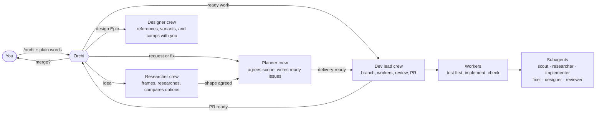

<div align="center">

# Orchi

### Say what you want. Get a reviewed, tested, documented PR.

Orchi turns Claude Code into a development team you run with one command.<br>
You type **`/orchi`** and talk in plain words. A pool of Claude sessions researches, plans, designs, and builds the work,<br>
and only the decisions that are yours come back to you.

**No controller. No database. Git holds the code and docs; GitHub Issues hold the plan.**

[Quick start](#quick-start) · [What it looks like](#what-it-looks-like) · [How it works](#how-it-works) · [What stays yours](#what-stays-yours) · [The gates](#the-gates) · [Under the hood](#under-the-hood) · [Docs](#documentation)

</div>

---

## Quick start

**1. Install** in your repository:

```bash
npx --yes github:nkhus/orchi --github
```

`--github` adds the Issue forms, the PR template, the documentation and standards checks, and Orchi's labels. If you leave it out, the first `/orchi` adds them, because the pool needs the labels.

**2. Start Orchi.** In Claude Desktop, open a session in the repository, switch it to **bypass permissions mode**, and type:

```text
/orchi
```

That session becomes Orchi. You don't commit or push anything: it commits and pushes the installation to `main` first, because its sessions, branches, and CI start from there. There is nothing more to set up: from now on, just tell Orchi what you want, and it starts a crew session for each request when it needs one and archives it when the work is done. Orchi is a persona: its session is always titled `Orchi`, and it files itself and every session it starts into one sidebar section, `Orchi pool · <repo>`. A crew's title names its role in brackets, such as `[planner] csv-export`.

When you want work to go on while you are away, turn on **autonomous mode** (say so, or click the button at the end of Orchi's report). Orchi then builds a pool of 3 crews and a dashboard, you click **`Create workers`** once in each crew, and each starts 3 workers; pool crews are cleared and reused instead of archived. From then on crews ask only Orchi, and Orchi takes the decisions and sends them as instructions. Turn it off to take the questions back.

The **dashboard** is optional: ask Orchi for one, and it comes with autonomous mode. It is a session of its own on Sonnet at low effort, which answers your questions about the pool. Click **`Refresh`** at the end of its turn, and a Haiku subagent updates its page with the crews and what each holds, the progress of every Initiative and Epic, what waits for you, PRs and their checks, and the planning queue, and its sidebar title sums it up (`📊 15:04 · 3 active · 1 wait for you · 2 PRs`). Orchi otherwise tells you only what needs you.

> **Needs** Git, an authenticated GitHub CLI (`gh`), Python 3.11+, and `uv`, on macOS, Linux, or WSL, and network access to GitHub: the installer also installs two design skills, [Hallmark](https://github.com/Nutlope/hallmark) and Emil Kowalski's [prototype](https://github.com/emilkowalski/skills), at pinned commits. Hallmark's own scripts use Node.js 18+ when it is there.

<details>
<summary><strong>Install for all projects, preview, upgrade, or remove</strong></summary>

```bash
npx --yes github:nkhus/orchi --global
```

| Option | Effect |
| --- | --- |
| `--project <path>` | Install into another directory instead of the current one |
| `--github` | Also add Issue forms, a PR template, the documentation and standards check workflows, and Orchi labels (project scope) |
| `--no-docs-workflow` | With `--github`, skip the documentation check workflow; `--docs-workflow` restores it |
| `--dry-run` | Show planned file changes, conflicts, and the labels `--github` would create, without writing |
| `--replace-orchi` | Back up and replace locally edited Orchi files and design skills |
| `--version` | Show the installed and bundled versions and the upgrade command |
| `--uninstall` | Remove the complete managed Orchi installation at the selected scope |

To upgrade, rerun the same command; unmodified managed files update in place. The [installation guide](docs/installation.md) covers paths, conflicts, upgrades from earlier versions, offline installation, and removal.

</details>

## What it looks like

An illustrative run. You only ever type in Orchi's session, or in a crew's session when Orchi links you there:

```text
you      /orchi add CSV export to the orders page
orchi    A planner has it. I linked you to its session.

planner  Large orders take a while. Stream the file, or email a download link?
         I recommend streaming: no mail setup, and it works offline.
you      stream it
planner  Planned: one Epic, three Tasks. Orchi takes it from here.

orchi    A dev lead is building it with two workers.
         ... each new test fails first, then passes · every check green · one full review ...
orchi    PR #112 is ready. Merge risk: two-way door, orders page only. Exceptions: none.
         Merge it?
you      yes
orchi    Merged. One lesson proposed, about a missing fixture. Accept it?
```

You never write a spec, a ticket, a branch name, or a line of code, and you never type a second command.

## How it works



**Orchi routes; it never does the work itself.** Each request gets its own crew session, named after its role and topic (for example `[planner] csv-export`), which talks to you there. A crew hands repository work to writer subagents, or in autonomous mode to its workers. When the work is done, Orchi archives the crew; a pool crew is cleared and returns to the pool instead.

**Work moves forward on its own.** A researcher who finishes shaping an idea continues as its planner in the same session. A finished plan goes on without you asking: the planner continues with the first item, and each other ready item gets a crew, or a start button when Orchi cannot start one itself. The design Epic starts with you while the first run is still being built; a merged first run unblocks the rest, and a merged design Epic the parts that build on its surfaces. While you test or brainstorm, name as many todos as you like: Orchi files each in your words and gives related ones to one planner, which queues them, or plans one in parallel in a sub-session nested under it when you click `Plan #<m> in parallel`; Orchi itself never works out how to build them. To update Orchi, tell it "update Orchi": it installs the new version and moves every session to it without losing what you discussed. If a session stops, Orchi sends the same assignment again, and the new session picks up from Git and GitHub.

**The ceremony scales with the work:**

| Scope | Branches | Reaches `main` as |
| --- | --- | --- |
| **Task**, a fix or small change | `fix/<slug>` | one PR |
| **Epic**, a feature | `epic/<tag>-<slug>`, with `task/*` branches for Tasks that run in parallel | one PR |
| **Initiative**, a large outcome | `initiative/<tag>-<slug>`, with one Epic PR into it per Epic | one final PR |

Titles carry their lineage: Initiative `[PAY] Card payments` → Epic `[PAY][TOKEN] Tokenize stored cards` → Task `[PAY][TOKEN] Add token column`.

**New product from one conversation.** Tell Orchi what you want to build. A researcher asks only product questions: who uses it, where it runs, what data it holds, the budget, and whether it is a proof of concept or meant to last. It fills the stack from Orchi's defaults: strict TypeScript, or Python for data work, and first proves with a quick prototype anything the idea cannot work without, such as an outside service or model. The first thing built is the first run: the product's core action working end to end, which you can open and try, on the stack with only the core checks. Before anything is planned, the researcher also designs the product with you: which screens it has and what each shows, grey wireframes of different panels to choose from, the sites you want it to feel like (it proposes some too), styled versions of the first screen from both of Orchi's design skills, side by side, each named by its idea, and finally a clickable mockup of the whole system. You rate and pick on a design board page. A design Epic then builds what you approved on the stack meanwhile, and the rest is planned at once and starts when the first run merges. Every other check arrives with the first change that needs it; a project meant to last gets the rest in a hardening Epic beside the product work.

**Prototype first.** For something entirely new, a product, a site, or an interface from scratch, say "prototype: <idea>", or click `Prototype first` when Orchi asks how to start. A prototyper interviews you in detail: who uses it, for which jobs, its screens, the data they show, and the sites it should feel like; in a repository that already has a product, it asks whether to reuse its style and work. Then it asks how many variants to build (three by default) and shows them on the design board, each a clickable mockup of the whole product in its own direction, and after each round asks whether to try more. The one you pick becomes a living prototype on its own page, with plausible sample data, to open beside the conversation or on your phone. Tell it what to change, or leave a comment on the page, while it keeps asking about states, edge cases, roles, and flows; it checks each change in the browser before you see it, and you can go back to any version. When you say to build it, every decision, idea, and rejected direction is written into the Exploration, and the exploration goes on as usual, with the prototype as your richest answer: research, directions, the design session, and the shape, each asking only what the prototype left open. Features, fixes, and redesigns of an existing product go the usual way.

## What stays yours

You work on the concept, the vision, and the design; Orchi decides everything technical and asks you only what it changes for you. Every user-only decision is written into its Issue first, so nothing is lost if you are away.

| Always yours | Orchi and its crews handle |
| --- | --- |
| What to build, the scope, and the order you see results in (with autonomous mode off) | Code, tests, branches, Issues, labels, PRs, and how work splits into them |
| The direction of an exploration (with autonomous mode off) | Research, options, and recommendations |
| Design references, every direction (your pick also sets the design engine), comp, and generated asset (with autonomous mode off) | Variants to choose from, and building against what you approved |
| Product constraints | The stack, tools, thresholds, exceptions, and CI |
| A yes to each merge into `main`, unless you turn on autonomous mode | Review, repairs, rechecks, and the merge itself |
| Hearing, in plain words, of every exception to a check | Deciding exceptions, applying the branch ruleset, and proposing lessons after each delivery |
| Deploys, access, money, and destructive actions; signing in to GitHub when asked | Keeping the documentation current, and every command, Git, and GitHub step: you never open a terminal |

**Autonomous mode.** It starts off: crews ask you in their own sessions, and Orchi tells you once when a crew is waiting. With it on, crews ask only Orchi, which decides what you would (an exploration's direction, the scope and breakdown, design references, directions, and comps, and what only you know, as stated assumptions) from each crew's recommendation, sends the decision as an instruction, and lists the product and design decisions in its report so you can revisit them. It merges a PR into `main` only when checks pass, no blocker or major finding is unresolved, every repair is rechecked, and the review confirmed every exception the PR adds. Money, access and credentials, deploys, and anything destructive or irreversible stay yours in both modes.

## The gates

Orchi assumes agents write all the code and nobody reads it. Tools and one rigorous review are the gate.

- **Agree before anything is tracked.** Research, a proposed scope, and the breakdown come first. Issues and branches follow your agreement, not an agent's guess. A declined idea is recorded with your reason and shown first if it comes back.
- **Tests first.** Every new test is shown failing before the change, and every acceptance criterion gets an acceptance test.
- **Standards enforced by CI.** `ENGINEERING.md` declares each check as a blocking CI job: format, lint, strict types, 90% coverage of changed lines, acceptance tests, accessibility (WCAG 2.2 AA), module boundaries, size limits, dead code, secrets, dependency and static security analysis, and licenses. An existing project gets an audit and one standards Epic.
- **No quiet loopholes.** Writers check their own diffs, and the review checks the whole range, for weakened gates: a suppression, a loosened config, a skipped or deleted test, a CI step that no longer fails. Each one needs a recorded exception, and each exception reaches you in plain words.
- **One full review, precise repairs.** Each Epic is reviewed for spec, scope creep, standards, and tests, plus a design audit against `DESIGN.md`, the approved comps, and accessibility when the UI changes. Only demonstrated defects are repaired, a review that finds nothing is a valid result, and repairs are rechecked once. After two misses, the Task's boundary changes instead of being retried.
- **Every PR explains itself.** It carries evidence for each criterion, every finding and its resolution, a merge risk (a one-way or two-way door, and the blast radius), its exceptions, and its documentation impact.
- **Docs that never go stale.** `main` holds only how the product works now: a map in `docs/README.md` assigns code to its pages, and each page keeps only the decisions still in force. Research, options, and plans live in `docs/work/` on the work's branch, settled decisions move into the current pages, and the folder is deleted before the merge.
- **It learns.** Each delivery proposes up to three lessons, each tied to something that happened and turned into a check, a form field, a coding standard, or a pointer. Nothing changes until you accept it.

## Under the hood

Orchi is a set of Claude Code skills and subagents. Git and GitHub are its only shared state: claims, labels, native sub-issues, `blocked by` dependencies, and PRs. Any session can restart and catch up.

<details>
<summary><strong>Skills</strong>: you type only <code>/orchi</code>; the rest are hidden role skills</summary>

| Skill | Run by | Does |
| --- | --- | --- |
| `orchi` | You (`/orchi [request]`) | Makes a session Orchi: starts a crew per request, builds the pool for autonomous mode, routes requests, assigns, releases, and archives crews, and tells you only about decisions, merges, and waiting questions |
| `orchi-explore` | Researcher crew | Shapes an idea with you in an `Exploration` Issue and an `explore/<slug>` branch, then continues into planning |
| `orchi-plan` | Planner crew | Proposes a scope, clarifies in rounds, shows the breakdown, creates ready Issues, and labels them `delivery-ready` |
| `orchi-standards` | Planner crew | Audits an existing project's checks and plans a standards Epic, or plans hardening when a project becomes meant to last |
| `orchi-design` | Designer crew | Runs a `design` Epic with you: references, the engine round between Hallmark and prototype in a project's first design Epic, a direction round and an approved comp per surface; builds go to writer subagents or workers |
| `orchi-deliver` | Dev lead crew | Delivers a Task, Epic, or Initiative through writer subagents or workers, one review, and a PR; never merges into `main` itself |
| `orchi-work` | Worker | Implements, fixes, or designs one Task, or answers one research question, as the matching subagent role |
| `orchi-dashboard` | Dashboard session | Refreshes the pool's status page through a Haiku subagent when you click `Refresh`, and answers questions about it; reads only, changes nothing |
| `orchi-core` | Every pool session | The workflow: scope, readiness, execution, testing, review, knowledge, standards, and the pool |

</details>

<details>
<summary><strong>Subagents</strong>: six model-tiered roles, rendered from <code>skills/orchi-core/roles/</code></summary>

| Agent | Model / effort | Writes | Role |
| --- | --- | --- | --- |
| `orchi-scout` | haiku / medium | nothing | Returns paths, line ranges, and excerpts |
| `orchi-researcher` | opus / medium | nothing | Answers a question from cited primary sources, or designs one option under a given lens |
| `orchi-implementer` | opus / medium | one commit per run | Runs the Task readiness gate, then implements and verifies one Task |
| `orchi-fixer` | sonnet / medium | one commit per run | Makes one small, fully specified change or a confirmed repair, and escalates anything larger |
| `orchi-reviewer` | opus / high | nothing | Reviews a Task, an assembled Epic, or a final Initiative candidate |
| `orchi-designer` | opus / medium | one commit per UI Task; variant files when building variants; nothing when auditing | Builds variants for a design round, builds one UI Task against the approved comp, or audits a UI diff, with the project's design engine |

Only the session that owns the work starts the writers (`orchi-implementer`, `orchi-fixer`, `orchi-designer`). Nested agents never talk to you, change Issues, push, or merge. See [subagent roles](skills/orchi-core/roles/README.md).

</details>

<details>
<summary><strong>What the installer adds to your project</strong></summary>

| File or directory | Purpose |
| --- | --- |
| `.claude/skills/orchi/` | The `/orchi` entry |
| `.claude/skills/orchi-core/` | The workflow, its references, and its scripts |
| `.claude/skills/orchi-explore/`, `orchi-plan/`, `orchi-design/`, `orchi-standards/`, `orchi-deliver/`, `orchi-work/`, `orchi-dashboard/` | Role skills, hidden from the menu |
| `.claude/agents/orchi-*.md` | The rendered subagents |
| Root `CLAUDE.md` | A managed section that sends work to `/orchi` |
| `.claude/skills/hallmark/`, `.claude/skills/prototype/` | The two design skills at pinned commits; a project designs with the one it picks |
| `.gitignore` | A managed section that ignores the pool's worktrees |
| `.github/ISSUE_TEMPLATE/orchi-*.yml`, `.github/workflows/orchi-docs.yml`, `orchi-standards.yml` | Issue forms and the documentation and standards checks, with `--github` |
| PR template | Summary, Verification, Merge risk, Exceptions, Documentation impact, and Handoff sections, with `--github` |
| `.claude/.orchi-install.json` | The manifest that upgrades and uninstalls rely on |

The installer keeps your own instructions. It maintains only the section between `<!-- orchi:begin -->` and `<!-- orchi:end -->` and refuses to overwrite a managed section you edited. Your repository's instructions take precedence over Orchi's defaults. The first `/orchi` commits the installation, which shares it with your team.

</details>

## Documentation

| Guide | Read it to… |
| --- | --- |
| [Documentation map](docs/README.md) | Find the page for each part of Orchi and the decisions in force |
| [Workflow](docs/workflow.md) | Follow exploration, planning, delivery, and review |
| [Pool](docs/pool.md) | See how Orchi, crews, and workers talk, and how modes work |
| [Design](docs/design.md) | See how a project picks its design engine and how UI work runs |
| [Standards](docs/standards.md) | See `ENGINEERING.md`, the default stack and checks, and gate integrity |
| [Context](docs/context.md) | See how documentation stays current |
| [Installation](docs/installation.md) | Install, upgrade, or remove Orchi |
| [Testing](docs/testing.md) | Validate the package and run the smoke test |

The [skill](skills/orchi-core/SKILL.md) is the complete workflow; its [references](skills/orchi-core/references/) cover each stage.

## Contributing

The installable skills live in `skills/` and the subagent roles in `skills/orchi-core/roles/`. Validation, tests, and repository documentation live in `tools/`, `tests/`, and `docs/`.

```bash
python3 -m venv .venv && . .venv/bin/activate
python -m pip install -r requirements-dev.txt
python tools/validate_package.py
python -m pytest -q
```

See [contributing](CONTRIBUTING.md). Deterministic tests establish installer and tool behavior, not live model quality.
