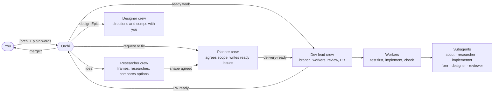

<div align="center">

# Orchi

### Say what you want. Get a reviewed, tested, documented PR.

Orchi turns Claude Code into a development team you run with one command.<br>
You type **`/orchi`** and talk in plain words. A pool of Claude sessions researches, plans, designs, and builds the work,<br>
and only the decisions that are yours come back to you.

**No controller. No database. Git holds the code and docs; GitHub Issues hold the plan.**

[Quick start](#quick-start) · [What it looks like](#what-it-looks-like) · [How it works](#how-it-works) · [What stays yours](#what-stays-yours) · [The gates](#the-gates) · [Under the hood](#under-the-hood) · [Docs](#documentation)

</div>

---

## Quick start

**1. Install** in your repository:

```bash
npx --yes github:nkhus/orchi --github
```

`--github` adds the Issue forms, the PR template, the documentation, design, and standards checks, and Orchi's labels. If you leave it out, the first `/orchi` adds them, because the pool needs the labels.

**2. Start Orchi.** In Claude Desktop, open a session in the repository, switch it to **bypass permissions mode**, and type:

```text
/orchi
```

That session becomes Orchi. You don't commit or push anything: it commits and pushes the installation to `main` first, because its sessions, branches, and CI start from there. Then it builds its pool: 5 crews, each in its own worktree. Click **`Create workers`** once in each crew, and each one starts 3 workers. That is the last setup step. From now on, just tell Orchi what you want.

Orchi also starts a **dashboard** session on Sonnet at low effort, which answers your questions about the pool. Every 10 minutes a Haiku subagent refreshes its live page with the crews and what each holds, the progress of every Initiative and Epic, what waits for you, PRs and their checks, and the planning queue, and its sidebar title sums it up (`📊 15:04 · 3 active · 1 wait for you · 2 PRs`). Orchi sends you the page's link and otherwise tells you only what needs you.

> **Needs** Git, an authenticated GitHub CLI (`gh`), Python 3.11+, Node.js 18.19+ with `npx`, and `uv`, on macOS, Linux, or WSL. The installer also installs [Impeccable](https://impeccable.style/), Orchi's design engine.

<details>
<summary><strong>Install for all projects, preview, upgrade, or remove</strong></summary>

```bash
npx --yes github:nkhus/orchi --global
```

| Option | Effect |
| --- | --- |
| `--project <path>` | Install into another directory instead of the current one |
| `--github` | Also add Issue forms, a PR template, the documentation, design, and standards check workflows, and Orchi labels (project scope) |
| `--no-docs-workflow` | With `--github`, skip the documentation check workflow; `--docs-workflow` restores it |
| `--dry-run` | Show planned file changes, conflicts, and the labels `--github` would create, without writing |
| `--replace-orchi` | Back up and replace locally edited Orchi files, and replace an Impeccable of another version with the pinned one |
| `--version` | Show the installed and bundled versions and the upgrade command |
| `--uninstall` | Remove the complete managed Orchi installation at the selected scope |

To upgrade, rerun the same command; unmodified managed files update in place. The [installation guide](docs/installation.md) covers paths, conflicts, upgrades from earlier versions, offline installation, and removal.

</details>

## What it looks like

An illustrative run. You only ever type in Orchi's session, or in a crew's session when Orchi links you there:

```text
you      /orchi add CSV export to the orders page
orchi    A planner has it. I linked you to its session.

planner  Large orders take a while. Stream the file, or email a download link?
         I recommend streaming: no mail setup, and it works offline.
you      stream it
planner  Planned: one Epic, three Tasks. Orchi takes it from here.

orchi    A dev lead is building it with two workers.
         ... each new test fails first, then passes · every check green · one full review ...
orchi    PR #112 is ready. Merge risk: two-way door, orders page only. Exceptions: none.
you      merge
orchi    Merged. One lesson proposed, about a missing fixture. Accept it?
```

You never write a spec, a ticket, a branch name, or a line of code, and you never type a second command.

## How it works



**Orchi routes; it never does the work itself.** Each request goes to a free crew, which takes a role, is renamed after its role and topic (for example `planner-csv-export`), and talks to you in its own session. Crews hand all repository work to their workers, and workers delegate to model-tiered subagents. When the work is done, everyone clears and returns to the pool.

**Work moves forward on its own.** A researcher who finishes shaping an idea continues as its planner in the same session. A finished plan goes to a dev lead without you asking. A merged foundation unblocks the design Epic, and a merged design Epic unblocks the rest. If a session stops, Orchi sends the same assignment again, and the new session picks up from Git and GitHub.

**The ceremony scales with the work:**

| Scope | Branches | Reaches `main` as |
| --- | --- | --- |
| **Task**, a fix or small change | `fix/<slug>` | one PR |
| **Epic**, a feature | `epic/<tag>-<slug>`, with `task/*` branches for Tasks that run in parallel | one PR |
| **Initiative**, a large outcome | `initiative/<tag>-<slug>`, with one Epic PR into it per Epic | one final PR |

Titles carry their lineage: Initiative `[PAY] Card payments` → Epic `[PAY][TOKEN] Tokenize stored cards` → Task `[PAY][TOKEN] Add token column`.

**New product from one conversation.** Tell Orchi what you want to build. A researcher asks only product questions: who uses it, where it runs, what data it holds, the budget, and whether it is a proof of concept or meant to last. It fills the stack from Orchi's defaults: strict TypeScript, or Python for data work. Then a foundation Epic sets up the stack and the blocking checks, a design Epic gives the product its look with you, and the rest is planned on top.

## What stays yours

You decide outcomes; Orchi decides how. Every user-only decision is written into its Issue first, so nothing is lost if you are away.

| Always yours | Orchi and its crews handle |
| --- | --- |
| What to build, the scope, and the breakdown (at Ask) | Code, tests, branches, Issues, labels, and PRs |
| The direction of an exploration | Research, options, and recommendations |
| Every design direction, comp, and generated asset | Building against what you approved |
| Product constraints | The stack, tools, thresholds, and CI |
| Merging into `main`, unless you turn on auto mode | Review, repairs, and rechecks |
| Every exception to a check, and applying the branch ruleset | Proposing lessons after each delivery |
| Deploys, access, money, and destructive actions | Keeping the documentation current |

**Modes.** Orchi starts interactive at autonomy Ask: crews ask you in their own sessions, and Orchi tells you once when a crew is waiting. Say `autonomy decide` to have crews show you each decision and carry on. Say `mode auto` to step away: Orchi answers planners and dev leads itself and merges a PR only when checks pass, no blocker or major finding is unresolved, every repair is rechecked, and the PR adds no exceptions. Researchers and designers still ask you. Say `mode interactive` to take back the questions.

## The gates

Orchi assumes agents write all the code and nobody reads it. Tools and one rigorous review are the gate.

- **Agree before anything is tracked.** Research, a proposed scope, and the breakdown come first. Issues and branches follow your agreement, not an agent's guess. A declined idea is recorded with your reason and shown first if it comes back.
- **Tests first.** Every new test is shown failing before the change, and every acceptance criterion gets an acceptance test.
- **Standards enforced by CI.** `ENGINEERING.md` declares each check as a blocking CI job: format, lint, strict types, 90% coverage of changed lines, acceptance tests, accessibility (WCAG 2.2 AA), module boundaries, size limits, dead code, secrets, dependency and static security analysis, and licenses. An existing project gets an audit and one standards Epic.
- **No quiet loopholes.** Writers check their own diffs, and the review checks the whole range, for weakened gates: a suppression, a loosened config, a skipped or deleted test, a CI step that no longer fails. Each one needs a recorded exception, and each exception reaches you in plain words.
- **One full review, precise repairs.** Each Epic is reviewed for spec, scope creep, standards, and tests, plus [Impeccable](https://impeccable.style/)'s design audit when the UI changes. Blockers go back to the writer that holds the context and are rechecked. After two misses, the Task's boundary changes instead of being retried.
- **Every PR explains itself.** It carries evidence for each criterion, every finding and its resolution, a merge risk (a one-way or two-way door, and the blast radius), its exceptions, and its documentation impact.
- **Docs that never go stale.** `main` holds only how the product works now: a map in `docs/README.md` assigns code to its pages, and each page keeps only the decisions still in force. Research, options, and plans live in `docs/work/` on the work's branch, settled decisions move into the current pages, and the folder is deleted before the merge.
- **It learns.** Each delivery proposes up to three lessons, each tied to something that happened and turned into a check, a form field, a coding standard, or a pointer. Nothing changes until you accept it.

## Under the hood

Orchi is a set of Claude Code skills and subagents. Git and GitHub are its only shared state: claims, labels, native sub-issues, `blocked by` dependencies, and PRs. Any session can restart and catch up.

<details>
<summary><strong>Skills</strong>: you type only <code>/orchi</code>; the rest are hidden role skills</summary>

| Skill | Run by | Does |
| --- | --- | --- |
| `orchi` | You (`/orchi [request]`) | Makes a session Orchi: builds the pool, routes requests, assigns and releases crews, and tells you only about decisions, merges, and waiting questions |
| `orchi-explore` | Researcher crew | Shapes an idea with you in an `Exploration` Issue and an `explore/<slug>` branch, then continues into planning |
| `orchi-plan` | Planner crew | Proposes a scope, clarifies in rounds, shows the breakdown, creates ready Issues, and labels them `delivery-ready` |
| `orchi-standards` | Planner crew | Derives the stack and checks from your product constraints: a foundation Epic, or an audit and a standards Epic |
| `orchi-design` | Designer crew | Runs a `design` Epic with you through Impeccable; builds go to workers |
| `orchi-deliver` | Dev lead crew | Delivers a Task, Epic, or Initiative through workers, one review, and a PR; never merges into `main` itself |
| `orchi-work` | Worker | Implements, fixes, or designs one Task, or answers one research question, as the matching subagent role |
| `orchi-dashboard` | Dashboard session | Refreshes the pool's live status page on a timer through a Haiku subagent and answers questions about it; reads only, changes nothing |
| `orchi-core` | Every pool session | The workflow: scope, readiness, execution, testing, review, knowledge, standards, and the pool |

</details>

<details>
<summary><strong>Subagents</strong>: six model-tiered roles, rendered from <code>skills/orchi-core/roles/</code></summary>

| Agent | Model / effort | Writes | Role |
| --- | --- | --- | --- |
| `orchi-scout` | haiku / medium | nothing | Returns paths, line ranges, and excerpts |
| `orchi-researcher` | opus / medium | nothing | Answers a question from cited primary sources, or designs one option under a given lens |
| `orchi-implementer` | opus / medium | one commit per run | Runs the Task readiness gate, then implements and verifies one Task |
| `orchi-fixer` | sonnet / medium | one commit per run | Makes one small, fully specified change or a confirmed repair, and escalates anything larger |
| `orchi-reviewer` | opus / high | nothing | Reviews a Task, an assembled Epic, or a final Initiative candidate |
| `orchi-designer` | opus / medium | one commit per UI Task; nothing when auditing | Builds one UI Task against the approved comp or direction, or audits a UI diff, with Impeccable |

Only the session that owns the work starts the writers (`orchi-implementer`, `orchi-fixer`, `orchi-designer`). Nested agents never talk to you, change Issues, push, or merge. See [subagent roles](skills/orchi-core/roles/README.md).

</details>

<details>
<summary><strong>What the installer adds to your project</strong></summary>

| File or directory | Purpose |
| --- | --- |
| `.claude/skills/orchi/` | The `/orchi` entry |
| `.claude/skills/orchi-core/` | The workflow, its references, and its scripts |
| `.claude/skills/orchi-explore/`, `orchi-plan/`, `orchi-design/`, `orchi-standards/`, `orchi-deliver/`, `orchi-work/`, `orchi-dashboard/` | Role skills, hidden from the menu |
| `.claude/agents/orchi-*.md` | The rendered subagents |
| Root `CLAUDE.md` | A managed section that sends work to `/orchi` |
| `.claude/skills/impeccable/`, `.claude/agents/impeccable-*.md` | Impeccable at the pinned version, without hooks |
| `.impeccable/config.json` | Impeccable's settings; telemetry is off unless the file already sets it |
| `.gitignore` | A managed section that ignores Impeccable's runtime files |
| `.github/ISSUE_TEMPLATE/orchi-*.yml`, `.github/workflows/orchi-docs.yml`, `orchi-design.yml`, `orchi-standards.yml` | Issue forms and the documentation, design, and standards checks, with `--github` |
| PR template | Summary, Verification, Merge risk, Exceptions, Documentation impact, and Handoff sections, with `--github` |
| `.claude/.orchi-install.json` | The manifest that upgrades and uninstalls rely on |

The installer keeps your own instructions. It maintains only the section between `<!-- orchi:begin -->` and `<!-- orchi:end -->` and refuses to overwrite a managed section you edited. Your repository's instructions take precedence over Orchi's defaults. The first `/orchi` commits the installation, which shares it with your team.

</details>

## Documentation

| Guide | Read it to… |
| --- | --- |
| [Documentation map](docs/README.md) | Find the page for each part of Orchi and the decisions in force |
| [Workflow](docs/workflow.md) | Follow exploration, planning, delivery, and review |
| [Pool](docs/pool.md) | See how Orchi, crews, and workers talk, and how modes work |
| [Design](docs/design.md) | See how UI work runs through Impeccable |
| [Standards](docs/standards.md) | See `ENGINEERING.md`, the default stack and checks, and gate integrity |
| [Context](docs/context.md) | See how documentation stays current |
| [Installation](docs/installation.md) | Install, upgrade, or remove Orchi |
| [Testing](docs/testing.md) | Validate the package and run the smoke test |

The [skill](skills/orchi-core/SKILL.md) is the complete workflow; its [references](skills/orchi-core/references/) cover each stage.

## Contributing

The installable skills live in `skills/` and the subagent roles in `skills/orchi-core/roles/`. Validation, tests, and repository documentation live in `tools/`, `tests/`, and `docs/`.

```bash
python3 -m venv .venv && . .venv/bin/activate
python -m pip install -r requirements-dev.txt
python tools/validate_package.py
python -m pytest -q
```

See [contributing](CONTRIBUTING.md). Deterministic tests establish installer and tool behavior, not live model quality.
